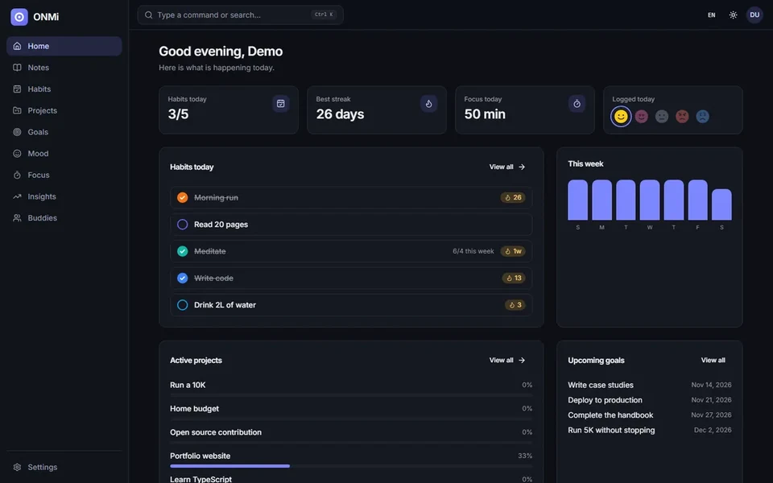
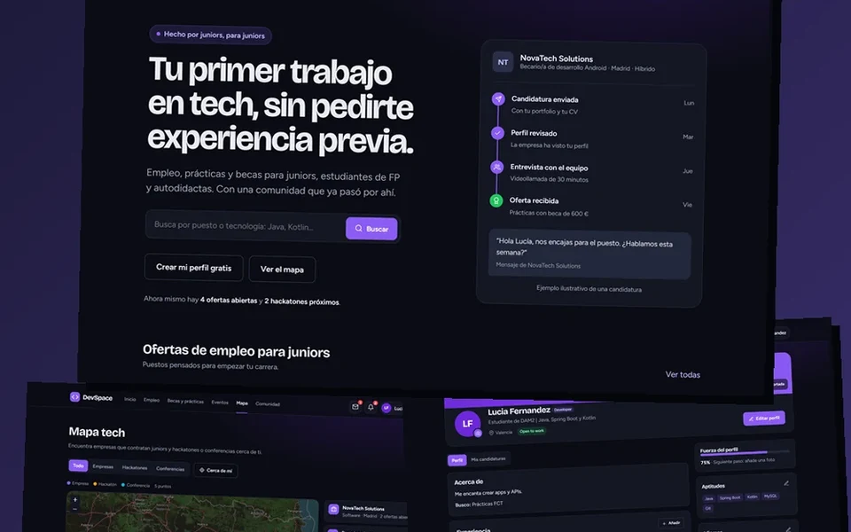
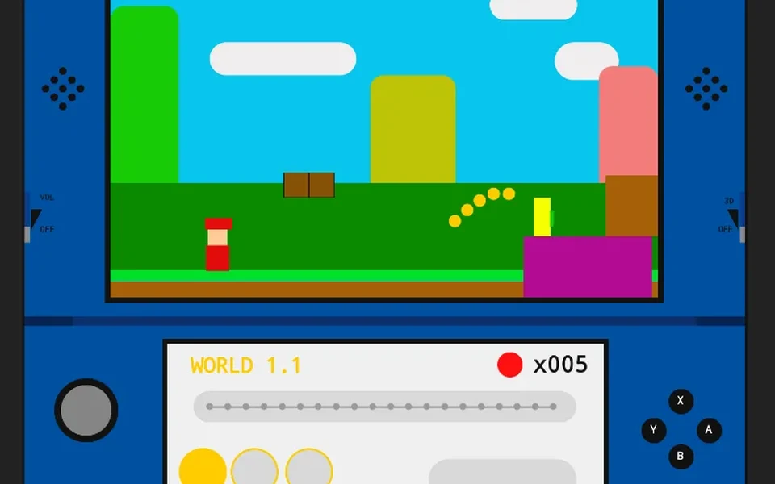
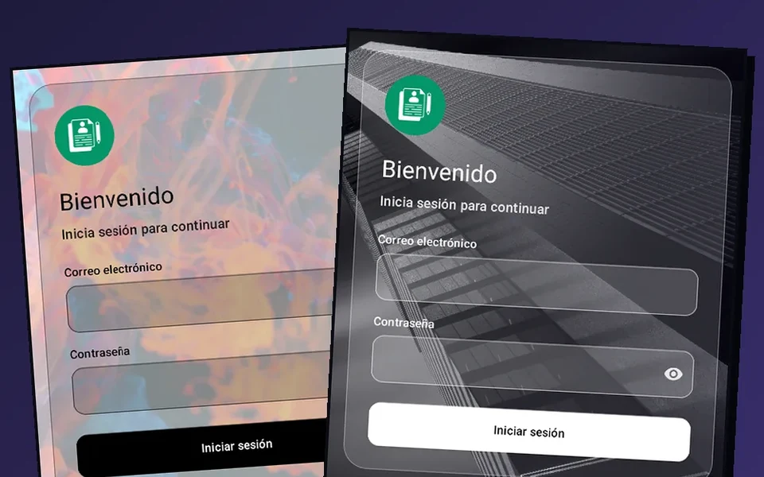
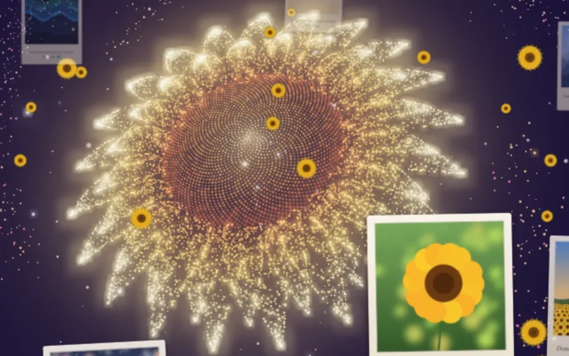
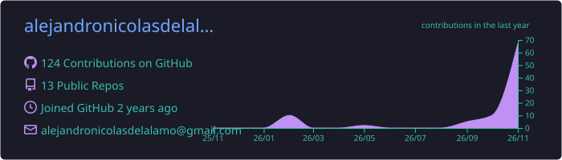
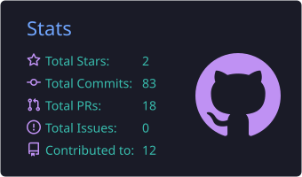
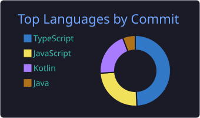

<!-- Cabecera -->
<p align="center">
  
</p>

<p align="center">
  <a href="https://alejandronicolasdelalamo.github.io">
    
  </a>
</p>

<p align="center">
  <a href="https://alejandronicolasdelalamo.github.io"></a>
  <a href="https://www.linkedin.com/in/alejandro-nicolas-del-alamo/"></a>
  <a href="mailto:alejandronicolasdelalamo@gmail.com"></a>
  <a href="https://alejandronicolasdelalamo.github.io/CV_Alejandro_Nicolas_del_Alamo.pdf"></a>
</p>

<p align="center">
  
  
  
  
</p>

---

## 👨‍💻 Sobre mí

<table>
<tr>
<td width="58%" valign="top">

Soy **desarrollador multiplataforma en formación**. Me gusta construir aplicaciones completas, **del backend a la interfaz**, y cuidar que funcionen bien y se vean bien.

- 🎓 Curso **2.º de DAM** en Ilerna y terminé el **bootcamp Full Stack de 4Geeks Academy** ([certificado](https://certificate.4geeks.com/f5d4e1b48e48de30a06580e04fce24cdd0f20010)).
- 🛠️ Ahora mismo construyo **DevSpace**, mi proyecto de fin de grado: red social y bolsa de empleo para developers junior.
- 🧪 Me tomo en serio la calidad: tests, CI con GitHub Actions y Docker.
- 💼 Compaginé estudios y trabajo en tienda (Supeco/Carrefour, Grupo Dia): sé organizarme y responder con prisa.
- 🌍 Español nativo · inglés avanzado.
- ⚽ Fuera del código: gimnasio, fútbol y baloncesto.

</td>
<td width="42%" valign="top">

```kotlin
data class Alejandro(
    val rol: String = "Dev multiplataforma",
    val ubicacion: String = "Madrid 🇪🇸",
    val estudios: String = "2.º DAM · Ilerna",
    val stack: List<String> = listOf(
        "Kotlin", "Java", "Spring Boot",
        "React", "TypeScript", "Python"
    ),
    val aprendiendo: String = "Arquitectura y testing",
    val disponible: String = "Prácticas · 2027"
)
```

</td>
</tr>
</table>

## 🧰 Tecnologías

<p align="center"><b>Lenguajes</b></p>
<p align="center">
  
</p>

<p align="center"><b>Frameworks y librerías</b></p>
<p align="center">
  
</p>

<p align="center"><b>Bases de datos, herramientas y DevOps</b></p>
<p align="center">
  
</p>

## 🚀 Proyectos destacados

<table>
<tr>
<td width="50%" valign="top">
<a href="https://github.com/alejandronicolasdelalamo/onmi"></a>

### [ONMi](https://github.com/alejandronicolasdelalamo/onmi)
App de productividad: hábitos, notas, proyectos, metas, ánimo y tiempo de enfoque.

✅ **146 tests** de backend · **95 %** de cobertura · **39 E2E** con Playwright<br/>
🔐 Passkeys · Docker · CI con GitHub Actions

   

**[🌐 Demo](https://onmi-z9vl.onrender.com/)** · **[📂 Código](https://github.com/alejandronicolasdelalamo/onmi)**
</td>
<td width="50%" valign="top">


### DevSpace <sub><sup>🚧 En desarrollo · TFG</sup></sub>
Red social y bolsa de empleo para developers junior: perfil y CV, ofertas, eventos en un mapa y mensajes.

🔑 API REST con **Spring Boot**, JWT y roles<br/>
✅ **167 pruebas de integración** contra el servidor real<br/>
📱 App Android con Jetpack Compose + servicio en Python

   
</td>
</tr>
<tr>
<td width="50%" valign="top">
<a href="https://github.com/alejandronicolasdelalamo/3DS"></a>

### [3DS en Compose](https://github.com/alejandronicolasdelalamo/3DS)
Una consola Nintendo 3DS dibujada **100 % con código** en Jetpack Compose, sin imágenes. Diseñada antes en Figma y escalable a cualquier pantalla.

  
</td>
<td width="50%" valign="top">
<a href="https://github.com/alejandronicolasdelalamo/Login_compose"></a>

### [Login Compose](https://github.com/alejandronicolasdelalamo/Login_compose)
Login y bienvenida con Material 3: animaciones de transición, validaciones con bloqueo por intentos, modo claro/oscuro y diseño adaptable a tablet.

  
</td>
</tr>
<tr>
<td width="50%" valign="top">
<a href="https://alejandronicolasdelalamo.github.io/21-de-septiembre/demo/"></a>

### [Galaxia girasol 3D](https://github.com/alejandronicolasdelalamo/21-de-septiembre)
Escena 3D interactiva con **Three.js** y shaders GLSL propios: una galaxia en forma de girasol con fotos en órbita. Sin paso de compilación.

  

**[🌐 Demo](https://alejandronicolasdelalamo.github.io/21-de-septiembre/demo/)**
</td>
<td width="50%" valign="top">

### [🌐 Mi portfolio](https://alejandronicolasdelalamo.github.io)
Web personal con proyectos, trayectoria y CV. **Next.js** (export estático), React, Tailwind y Motion, publicada en GitHub Pages.

 

### [☕ CRUD con Spring Boot](https://github.com/alejandronicolasdelalamo/ProyectoTrenAccesoDatos)
Monolito con capas Controller/Service/Repository, Thymeleaf, Bootstrap 5 y MySQL.

 

<p align="center"><br/><a href="https://alejandronicolasdelalamo.github.io"></a></p>
</td>
</tr>
</table>

## 📊 Estadísticas

<p align="center">
  
</p>

<p align="center">
  
  
</p>

<p align="center">
  
</p>

<p align="center">
  
</p>

<p align="center">
  <picture>
    <source media="(prefers-color-scheme: dark)" srcset="https://raw.githubusercontent.com/alejandronicolasdelalamo/alejandronicolasdelalamo/output/github-snake-dark.svg" />
    <source media="(prefers-color-scheme: light)" srcset="https://raw.githubusercontent.com/alejandronicolasdelalamo/alejandronicolasdelalamo/output/github-snake.svg" />
    
  </picture>
</p>

## 🤝 ¿Hablamos?

<p align="center">
  Busco <b>prácticas como desarrollador</b> a partir de la <b>primavera de 2027</b> (Madrid o remoto).<br/>
  Si tu equipo construye apps Android, backends en Java o webs en React, me encantará conocerlo.
</p>

<p align="center">
  <a href="mailto:alejandronicolasdelalamo@gmail.com"></a>
  <a href="https://www.linkedin.com/in/alejandro-nicolas-del-alamo/"></a>
</p>

<p align="center">
  
</p>
